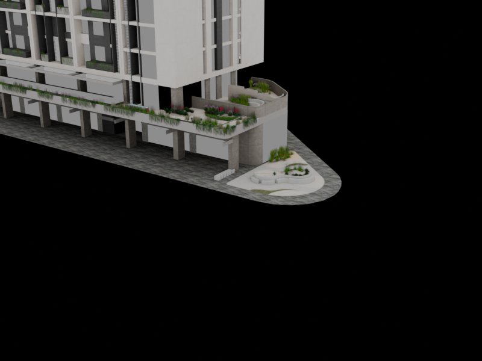

# 🏢 Torre Garten — Premium Real Estate & 360° Virtual Tour Platform

Torre Garten — 14 mərtəbəli premium yaşayış kompleksi üçün hazırlanmış interaktiv 3D bina baxışı, 2D memarlıq mərtəbə planı və 8K Ultra-HD 360° virtual tur platforması.

🌐 **Canlı Demo (Live Website)**: [https://tural1227.github.io/torre-garten/](https://tural1227.github.io/torre-garten/)



---

## ✨ Əsas Xüsusiyyətlər

- **3D Realist Model (Torre Garten)**: 
  - 14 müstəqil yaşayış mərtəbəsi və 56 lüks mənzil.
  - Günəş və təbii işıqlandırma, ACESFilmic ton tonlaması, fotorealist səma inikası.
  - Gecə və gündüz rejimləri, kinematik dron uçuşu və 360° orbit nəzarəti.
- **İnteraktiv İşıqlanan Mərtəbələr**:
  - Binada mərtəbələrin üzərinə gəldikdə parlaq qızılı-sarı işıqlanma.
  - Mərtəbəyə kliklədikdə fasaddan birbaşa içəri hamar kamera uçuşu və 2D memarlıq planına keçid.
- **2D Memarlıq CAD Planı**: 
  - Hər bir otaq (Qonaq otağı, Master yataq, Mətbəx, Sanuzel, Eyvanlar) fərdi olaraq seçilə və vurğulana bilir.
  - Otaq adları və kvadrat metrləri yüksək kontrastlı həblərdə toqquşmasız yerləşdirilib.
  - Plan daxilindən birbaşa 14 mərtəbə arasında naviqasiya və mebellər / CAD çertyoj qatı açarı.
- **8K Ultra-HD 360° Virtual Tur**:
  - Orijinal büllur kimi aydın 8K panoramalar (Qonaq zalı, Master yataq, Şöminə zalı, En-Suite vanna, Panoramik terras süiti).
  - Otaqlar arası interaktiv 3D qapı keçidləri (`🚪 Qapıdan Keç`).
  - Real-vaxtda istifadəçinin baxış bucağını göstərən dinamik mini-radar xəritəsi.
  - Avto-tur və tam ekran rejimləri.
- **İnzibatçı Paneli (Admin CRM)**:
  - Mənzillərin qiymətini, sahəsini və satış/rezerv statusunu idarə etmək üçün tam panel.
  - Müştəri sorğuları və rezervasiya idarəetməsi.
  - Satış statistikası və dövriyyə hesabatı.

---

## 🛠️ İstifadə Edilmiş Texnologiyalar

- **Three.js & GLTFLoader**: 3D model renderi, kölgələr, ACESFilmic ton xəritələnməsi və 360° ekvirektangular sfera.
- **OrbitControls**: İnteraktiv kamera manipulyasiyası və hədəf fokuslanması.
- **Lucide Icons**: İnterfeys ikonları.
- **SVG & Canvas**: Memarlıq CAD çertyoju, otaq zonalanması və real-vaxt radarı.
- **Vanilla JavaScript**: Sıfır asılılıq, sürətli və 100% oflayn/onlayn işlək arxitektura.

---

## 🚀 Lokal Başlatmaq Üçün

Saytı lokal olaraq başlatmaq üçün:

```bash
python server.py
# və ya
start.bat
```

Brauzerdə `http://127.0.0.1:3000/` ünvanını açın.
