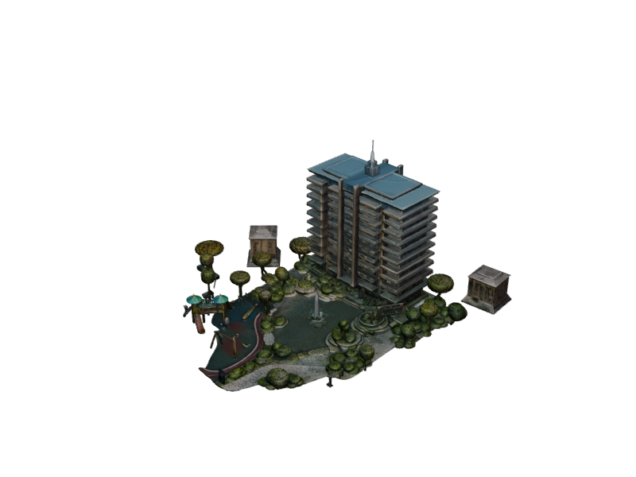

# 🏢 DIGIWYZE — Digital Residential Twin & 360° Virtual Tour Platform

**DIGIWYZE** — 14 mərtəbəli premium yaşayış kompleksi üçün hazırlanmış interaktiv 3D rəqəmsal əkiz, Digiwyze mənzil filtrləmə sistemi, 2D memarlıq mərtəbə planı və 8K Ultra-HD 360° gəzinti virtual tur platforması.

🌐 **Canlı Demo (Live Website)**: [https://tural1227.github.io/digiwyze/](https://tural1227.github.io/digiwyze/)



---

## ✨ Əsas Xüsusiyyətlər

- **Digiwyze 3D Rəqəmsal Əkiz**: 
  - 14 müstəqil yaşayış mərtəbəsi və 56 lüks mənzil.
  - Ağıllı Otaq və Satış Filtri (1, 2, 3, 4 otaqlı və satışda olan mənzillər).
  - Təbii işıqlandırma, ACESFilmic ton tonlaması, fotorealist səma inikası.
  - İnteraktiv Zoom In (+) və Zoom Out (-) idarəetməsi, kinematik dron uçuşu və 360° orbit nəzarəti.
- **İnteraktiv İşıqlanan Mərtəbələr**:
  - Binada mərtəbələrin üzərinə gəldikdə parlaq qızılı-sarı işıqlanma.
  - Tək kliklə məlumat kartı, iki dəfə kliklə və ya düymə ilə 2D memarlıq planına keçid.
- **2D Memarlıq CAD Planı**: 
  - Hər bir otaq fərdi olaraq seçilə və interaktiv vurğulana bilir.
  - 4 mənzil üçün birbaşa plan daxilində sürətli seçim həbləri (Apartment Selector Pills).
  - Rahat çıxış düyməsi və ESC klaviatura dəstəyi ilə 3D-yə qayıdış.
- **8K Ultra-HD 360° Virtual Tur və İnteraktiv Otaq Gəzintisi**:
  - Orijinal büllur kimi aydın 8K panoramalar (Qonaq zalı, Master yataq, Şöminə zalı, En-Suite vanna, Panoramik terras süiti).
  - **Otaq daxilində irəli və geri addımlama (Walkthrough)**: W / S düymələri, oxlar və ekrandakı "İrəli / Geri" düymələri ilə real gəzinti.
  - **Otaqlar arası ani keçid**: Yaddaşda keşlənmiş teksturalarla 0 gecikmə ilə keçid.
  - Qapılarda interaktiv 3D keçid nöqtələri (`🚪 Qapıdan Keç`).
  - Real-vaxtda baxış bucağını göstərən dinamik mini-radar xəritəsi.
- **İnzibatçı Paneli (Admin CRM)**:
  - Mənzillərin qiymətini, sahəsini və statusunu real vaxtda redaktə etmək.
  - Müştəri sorğuları və rezervasiya idarəetməsi.
  - Satış statistikası və dövriyyə hesabatı.

---

## 🛠️ İstifadə Edilmiş Texnologiyalar

- **Three.js & GLTFLoader**: 3D bina renderi, kölgələr, ACESFilmic ton xəritələnməsi və 360° ekvirektangular sfera.
- **OrbitControls**: İnteraktiv kamera manipulyasiyası və hədəf fokuslanması.
- **Lucide Icons**: İnterfeys ikonları.
- **SVG & Canvas**: Memarlıq CAD çertyoju, otaq zonalanması və real-vaxt radarı.
- **Vanilla JavaScript**: Sıfır asılılıq, sürətli və 100% oflayn/onlayn işlək arxitektura.

---

## 🚀 Lokal Başlatmaq Üçün

Saytı lokal olaraq başlatmaq üçün:

```bash
python server.py
# və ya
start.bat
```

Brauzerdə `http://127.0.0.1:3000/` ünvanını açın.
